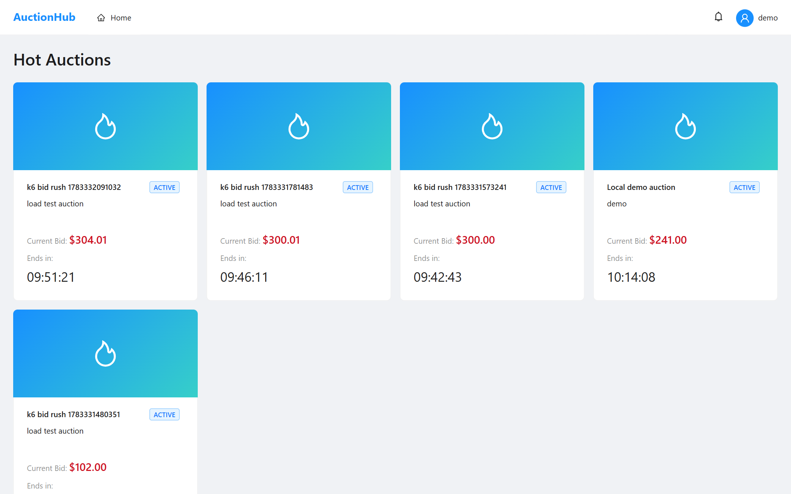
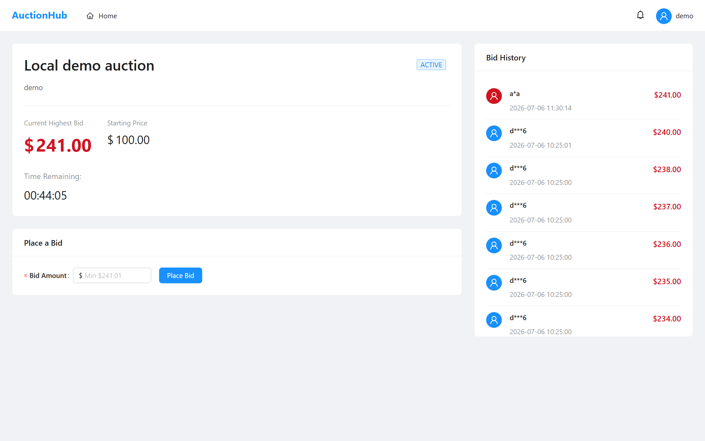

# High-Concurrency Auction Platform

[](https://github.com/WeiGuang-2099/High-concurrency-Distributed-Event-Driven-System/actions/workflows/ci.yml)

A real-time auction and ticketing platform built with a distributed event-driven architecture. The system handles two high-concurrency scenarios: **flash auctions** (thousands of users bidding simultaneously) and **ticket rushes** (thousands of users buying limited stock). Both scenarios are protected against overselling and data races using Redis Lua scripts, MySQL optimistic locking, and transactional compensation.

> **Load-tested (k6):** zero oversell under **200 concurrent buyers** (2,000 simultaneous reserve attempts on 100 stock → exactly 100 sold), a Redis-Lua vs pessimistic-lock benchmark showing **~1.5x throughput** at lower tail latency, and a pure-Redis auction-bid path sustaining **thousands of bids/s with no lost bids** — guaranteed by an outbox rather than merely not observed. See [Performance & Load Testing](#performance--load-testing).

## Screenshots

Home — hot auctions (Redis-cached) with live countdowns:



Auction detail — bids validated atomically by a Redis Lua script; the bid history and current highest price update in real time via WebSocket (STOMP) push from the notification service (usernames masked server-side):



## Tech Stack

| Layer | Technology | Role in this project |
|-------|-----------|---------------------|
| **Language / Framework** | Java 17, Spring Boot 3.2.5 | Application runtime |
| **Microservices** | Spring Cloud 2023.0.1 | Service discovery, config, gateway |
| **Service Discovery** | Netflix Eureka (Spring Cloud Netflix) | Service registry for gateway routing + Feign calls |
| **Centralized Config** | Spring Cloud Config Server | Shared configuration from the `config-repo/` directory (git-backed) |
| **API Gateway** | Spring Cloud Gateway | Routing, JWT authentication, per-user rate limiting (Redis token bucket), CORS, traceId injection |
| **Message Broker (Events)** | Apache Kafka 3.6.1 (KRaft mode) | Domain event propagation (bid placed, stock reserved, order created, etc.) |
| **Message Broker (Delayed)** | RabbitMQ 3 + delayed-message-exchange plugin | Order/reservation timeout (30 min auto-cancel) |
| **Relational DB** | MySQL 8.0 + MyBatis-Plus 3.5.6 | Transactional data (users, auctions, tickets, orders) |
| **In-Memory Store** | Redis 7 | Atomic stock deduction (Lua), atomic bid validation (Lua), token blacklist, hot-auction cache |
| **Document DB** | MongoDB 7 | Event sourcing store, CQRS read-side projections |
| **Distributed Transactions** | Application-level compensation saga | Cross-service consistency for auction settlement (reserve stock + create order, with compensation + retry on failure) |
| **Event Durability** | Transactional outbox — MySQL table (ticket) and Redis Stream (bid) | An accepted write and its event are recorded atomically, so a broker outage cannot lose the event ([ADR-0005](docs/adr/0005-redis-stream-outbox-for-bid-durability.md), [ADR-0007](docs/adr/0007-transactional-outbox-for-mysql-backed-paths.md)) |
| **Observability** | Micrometer Tracing + Brave, Zipkin, ELK 8.12 | Distributed tracing (one trace id shared by Zipkin spans and Kibana logs), structured JSON log aggregation |
| **Frontend** | React 18, TypeScript, Ant Design 5, React Query, Zustand | SPA with real-time WebSocket notifications |

## Architecture

> **Why it looks like this:** the decisions behind this design — including two that reversed an
> earlier choice — are recorded as [Architecture Decision Records](docs/adr/). Start there for
> *why Redis Lua instead of a row lock* ([0002](docs/adr/0002-redis-lua-for-oversell-protection.md)),
> *why Seata was removed* ([0003](docs/adr/0003-replace-seata-with-compensation-saga.md)), and
> *how an accepted bid is made durable* ([0005](docs/adr/0005-redis-stream-outbox-for-bid-durability.md)).

```
                              ┌──────────────────────────┐
                              │    Frontend (React SPA)   │
                              └────────────┬─────────────┘
                                           │ HTTP / WebSocket
                              ┌────────────▼─────────────┐
                              │   Gateway Service :8080   │
                              │  JWT auth · CORS · TraceId│
                              └───┬────┬────┬────┬────┬───┘
                  ┌──────────────┼────┼────┼────┼────┼──────────────┐
                  │              │    │    │    │    │              │
           ┌──────▼─────┐ ┌──────▼──┐ ┌▼────┴──┐ ┌▼─────┐ ┌────────▼────────┐
           │User Service│ │Auction  │ │Ticket  │ │Order │ │Notification     │
           │   :8086    │ │Service  │ │Service │ │Svc   │ │Service :8084    │
           │register    │ │ :8081   │ │ :8082  │ │:8083 │ │WebSocket push   │
           │login(JWT)  │ │bid(Lua) │ │reserve │ │pay   │ │Kafka consumer   │
           └──────┬─────┘ └──┬──┬───┘ └──┬─────┘ └──┬───┘ └────────┬────────┘
                  │          │  │        │          │              │
                  │     ┌────┘  │        │     ┌────┘              │
                  │     ▼       ▼        ▼     ▼                   │
           ┌──────┴────────────────────────────────────┐           │
           │              Kafka Topics                  │           │
           │  auction-events · ticket-events            │           │
           │  order-events                               │           │
           └─────────────────────┬──────────────────────┘           │
                                 │                                  │
                      ┌──────────▼──────────┐                       │
                      │Event Store Service  │                       │
                      │      :8085          │                       │
                      │ MongoDB append-only │◄──────────────────────┘
                      │ + CQRS projections  │
                      └─────────────────────┘

    ┌─────────────────────────────────────────────────────────┐
    │                    Data Stores                           │
    │  MySQL 8 (5 DBs)  ·  Redis 7  ·  MongoDB 7              │
    │  RabbitMQ 3 (delayed msg)                                │
    └─────────────────────────────────────────────────────────┘
```

### Data Flow: Ticket Purchase (Oversell Prevention)

```
User → Gateway → Ticket Service
                     │
                     ├─ 1. Redis Lua script: atomically check + decrement stock
                     │     (returns immediately if insufficient)
                     │
                     ├─ 2. MySQL transaction: insert reservation + increment reserved_count
                     │     + insert StockReservedEvent into the outbox table (same tx)
                     │     └─ If MySQL rolls back → the event row rolls back with it,
                     │        and Redis is compensated via the afterCompletion hook
                     │
                     ├─ 3. OutboxRelay (polls) → publishes to Kafka → stamps sent_at
                     │     └─ Event Store consumes → appends to MongoDB
                     │     └─ Notification Service consumes → WebSocket push
                     │
                     └─ 4. After commit: delayed message to RabbitMQ (30 min timeout)
                           └─ If not confirmed in time → auto-release stock in Redis + MySQL
                           └─ If the release keeps failing → dead-letter queue, never a
                              redelivery loop that stalls the queue
```

### Data Flow: Auction Bid

```
User → Gateway → Auction Service
                     │
                     ├─ 1. Redis Lua script (ONE atomic step): verify auction is ACTIVE
                     │     and bid amount > current highest, update the highest bid hash,
                     │     and XADD the accepted bid to the outbox stream
                     │     └─ Accept and record cannot come apart: 201 is never returned
                     │        for a bid that was not durably recorded
                     │
                     ├─ 2. BidOutboxRelay: XREADGROUP → publish to Kafka → XACK
                     │     └─ Event ids derive from the stream entry id, so a replay
                     │        after a crash is deduplicated, not double-counted
                     │     └─ If previous bidder exists → also publish BidOutbidEvent
                     │
                     └─ 3. Event Store appends to MongoDB
                         Notification Service pushes real-time updates via WebSocket
                         Bid persistor writes the MySQL bid row (dedupes on event id)

Scheduler (every 1s):
  ├─ Activate auctions whose startTime has passed (PENDING → ACTIVE)
  └─ Settle auctions whose endTime has passed (ACTIVE → SETTLED)
        ├─ If highest bid exists → settlement saga: reserve stock, then create order;
        │     if order creation fails, compensate (release stock) and retry next tick
        └─ If no bids → mark EXPIRED
```

## Project Structure

```
.
├── auction-common/            # Shared DTOs, event classes, exception handling, security context
├── gateway-service/           # API gateway: routing, JWT verification (RSA public key), traceId filter
├── user-service/              # User registration, login (RSA-signed JWT), profile management
├── auction-service/           # Auction CRUD, atomic bidding (Lua), lifecycle scheduler, settlement saga
├── ticket-service/            # Stock management, atomic reserve/confirm/cancel (Lua), timeout handling
├── order-service/             # Order state machine, mock payment, CAS status transitions, timeout expiry
├── notification-service/      # Kafka event consumers, WebSocket (STOMP) push, notification persistence
├── event-store-service/       # MongoDB event sourcing, CQRS projections, snapshot + replay API
├── frontend/                  # React 18 + TypeScript SPA (Ant Design, React Query, WebSocket)
├── eureka-server/             # Service registry (Netflix Eureka, :8761)
├── config-server/             # Centralized config (Spring Cloud Config, :8888, serves config-repo/)
├── config-repo/               # Centralized configuration served by config-server
├── deploy/                    # MySQL init scripts, RabbitMQ image, Logstash pipeline
└── docker-compose.yml         # Infrastructure: MySQL, Redis, MongoDB, Kafka, RabbitMQ, ELK, Zipkin
```

## Core Technical Highlights

### 1. Atomic Stock Deduction with Redis Lua + MySQL Compensation

Ticket oversell prevention uses a two-layer approach:

- **Redis Lua script** (`reserve_ticket.lua`) performs an atomic check-and-decrement. If `stock < quantity`, it returns immediately without modifying state. This handles thousands of concurrent requests with zero oversell.
- **MySQL transaction** then creates the reservation record and increments `reserved_quantity`. If the MySQL transaction fails and rolls back, a `TransactionSynchronization.afterCompletion` hook compensates Redis by incrementing the stock back.
- The compensation runs **after** the MySQL commit/rollback decision, ensuring Redis and MySQL never diverge.

### 2. Atomic Bid Validation with Redis Lua

The `place_bid.lua` script checks auction status (`ACTIVE`) and validates the bid amount exceeds the current highest in a single atomic Redis operation. This prevents race conditions where two bids arrive simultaneously and both see the same "current highest" value.

### 3. Dual Message Broker Architecture

- **Kafka** carries all domain events (`auction-events`, `ticket-events`, `order-events`). Producers use idempotent delivery (`acks=all`, `enable.idempotence=true`), consumers use manual acknowledgment with dead-letter topics.
- **RabbitMQ** with the `rabbitmq_delayed_message_exchange` plugin handles time-delayed operations: order payment timeout (30 min) and ticket reservation expiry. When a delayed message fires, the consumer checks if the reservation/order is still pending before releasing stock.

### 4. Event Sourcing with MongoDB + CQRS Projections

The `event-store-service` maintains an append-only event log in MongoDB:

- **EventStoreConsumer** subscribes to all Kafka topics and appends every domain event with a monotonically increasing sequence number per aggregate. Idempotency is enforced via a unique index on `eventId`.
- **Projection consumers** (separate consumer groups) build materialized views: bid history, order timeline, stock movement log, auction summary.
- **Snapshot + Replay**: every 100 events per aggregate, a snapshot is stored. The `/api/admin/events/replay/{aggregateType}/{aggregateId}` endpoint reconstructs aggregate state from the latest snapshot plus subsequent events.
- **Query API** (`/api/event-store/*`) reads exclusively from projections, never touching the write-side event stream.

## Performance & Load Testing

The two hot write paths — ticket reserve (flash sale) and auction bid — are load-tested with [k6](https://k6.io). Service benchmarks hit the service **in isolation** on a single laptop (Java 21, Tomcat, HikariCP) with MySQL / Redis / Kafka / RabbitMQ in Docker — isolating the service under test from gateway, JWT, and other JVMs is the correct setup for a benchmark. **Full methodology, environment, and raw metrics: [loadtest/REPORT.md](loadtest/REPORT.md).**

| Scenario | Setup | Result |
|----------|-------|--------|
| **Oversell correctness** | 200 concurrent VUs · 2,000 reserve attempts on 100 stock | **Exactly 100 sold, 0 oversold, 0 server errors** · p99 683 ms · ~921 req/s |
| **Sustained throughput** | 200 VUs · 10,000 reserves on one hot stock row | **10,000 / 10,000 succeeded, 0 oversold** · ~261 req/s · p99 1.17 s |
| **Optimistic vs pessimistic** | 50 VUs · 8,000 reserves · Redis-Lua vs `SELECT … FOR UPDATE` | **Redis-Lua ~282 req/s vs pessimistic ~185 req/s (~1.5x)** · both 0 oversold |
| **Auction bid throughput** | 200 VUs · 20,000 bids on **one** auction (pure-Redis Lua CAS, async outbox→Kafka→MySQL persistence) | **~2,400–3,560 bids/s** depending on machine state, p95 71 ms, 0 errors · **0 lost bids** · Redis == MySQL snapshot == max bid row |
| **Gateway rate limiting** | Through the gateway: 1 user at 30 req/s vs 5 users at 2 req/s each (per-user Redis token bucket: 5/s + burst 10) | **Abuser: 106 of 601 passed (theory 110), 495 got 429; compliant users: zero 429s** |

- **Oversell is verified by a post-run invariant** (`reserved + sold ≤ total`), not assumed — and the Redis decrement count always matches MySQL's `reserved_quantity`, so the two stores never diverge under saturation.
- **The optimistic/pessimistic comparison quantifies a design tradeoff:** moving the contention check into a Redis Lua script shortens how long each request holds the MySQL row lock, yielding ~1.5x throughput over `SELECT … FOR UPDATE` at equal correctness.
- **The bid path shows the other end of the spectrum (~10x the reserve success path):** a reserve success writes MySQL synchronously on the request thread (~261 req/s); a bid touches only Redis (Lua compare-and-set on the highest-bid hash) and defers durability to an outbox → relay → Kafka → consumer → MySQL. The post-run invariant proves the deferral is safe: every accepted bid reached MySQL and all three views of the highest price converged.
- **The bid throughput is a range, not a number, and the range is the honest part.** Adding the outbox looked like a 30% regression against the previously recorded ~3,560 bids/s — until the old code was re-measured *in the same session* and scored 2,512–3,004 on the same loaded laptop. The outbox's cost is below this machine's run-to-run noise; the ~3,560 reflects a cleaner machine, not a faster design. Only ~4% of requests (the accepted ones) reach the outbox write at all. Numbers here are only comparable within a session — see [Scenario 6](loadtest/REPORT.md).

## Getting Started

### Prerequisites

- Docker and Docker Compose
- Java 17 (for building services)
- Node.js 18+ (for frontend development)
- ~10 GB free RAM for all containers

### Start Infrastructure

```bash
docker-compose up -d
```

This starts 10 containers: MySQL, Redis, MongoDB, Kafka (KRaft), RabbitMQ, Zipkin, Elasticsearch, Logstash, Kibana. Wait ~2 minutes for all health checks to pass.

### Build and Run Services

```bash
# Build all services
mvn clean package -DskipTests

# 1. Start the registry and the config server first (from the repo root, so the
#    config server finds config-repo/)
java -jar eureka-server/target/eureka-server-1.0.0-SNAPSHOT.jar
java -jar config-server/target/config-server-1.0.0-SNAPSHOT.jar

# 2. Run each business service (in separate terminals)
java -jar user-service/target/user-service-1.0.0-SNAPSHOT.jar
java -jar auction-service/target/auction-service-1.0.0-SNAPSHOT.jar
java -jar ticket-service/target/ticket-service-1.0.0-SNAPSHOT.jar
java -jar order-service/target/order-service-1.0.0-SNAPSHOT.jar
java -jar notification-service/target/notification-service-1.0.0-SNAPSHOT.jar
java -jar event-store-service/target/event-store-service-1.0.0-SNAPSHOT.jar
java -jar gateway-service/target/gateway-service-1.0.0-SNAPSHOT.jar
```

### Observability

Every service is instrumented with **Micrometer Tracing + Brave**. Each request gets a
trace id that propagates across the gateway and all Feign calls (B3 headers) and is reported
to **Zipkin** as a span tree. In the servlet services the trace id is also injected into the
SLF4J MDC, so the **same trace id** appears in both the Zipkin trace and the structured logs
(grab a trace id from Zipkin, search it in Kibana to see that request's logs across services).

> Note: the gateway is reactive (Spring Cloud Gateway / WebFlux), where the trace context
> lives in the Reactor context rather than a thread-local. It still creates and reports spans
> to Zipkin and propagates B3 downstream, but its own log lines do not carry the MDC trace id.

Logs are JSON via a shared `logback-spring.xml` (in `auction-common`, inherited by all
services). To ship them to ELK, start the services with the `elk` profile so the Logstash
appender is active (Logstash → Elasticsearch `auction-logs-*` → Kibana):

```bash
java -jar user-service/target/user-service-1.0.0-SNAPSHOT.jar --spring.profiles.active=elk
```

Without the profile, logs stay on the console (so a missing Logstash never spams reconnect
errors). The tracing endpoint and sampling live in `config-repo/application.yml`, served to
every service by the config server.

### Run Frontend

```bash
cd frontend
npm install
npm run dev
```

### Access Points

| Service | URL |
|---------|-----|
| Frontend | http://localhost:5173 |
| API Gateway | http://localhost:8080 |
| Eureka Dashboard | http://localhost:8761 |
| Zipkin UI | http://localhost:9411 |
| Kibana | http://localhost:5601 |
| RabbitMQ Management | http://localhost:15672 (guest/guest) |

### Service Port Allocation

| Service | Port |
|---------|------|
| gateway-service | 8080 |
| auction-service | 8081 |
| ticket-service | 8082 |
| order-service | 8083 |
| notification-service | 8084 |
| event-store-service | 8085 |
| user-service | 8086 |
| eureka-server | 8761 |
| config-server | 8888 |

## API Overview

All API responses use a unified envelope:

```json
{
  "code": 200,
  "message": "success",
  "data": { ... },
  "timestamp": "2026-05-21T10:30:00Z",
  "traceId": "abc123"
}
```

### User Service (`/api/users`)

| Method | Endpoint | Description | Auth |
|--------|----------|-------------|------|
| POST | `/register` | Register a new user | Public |
| POST | `/login` | Login, returns RSA-signed JWT | Public |
| POST | `/logout` | Logout, adds token JTI to Redis blacklist | Required |
| GET | `/me` | Get current user profile | Required |
| PUT | `/me` | Update profile (email) | Required |

### Auction Service (`/api/auctions`)

| Method | Endpoint | Description | Auth |
|--------|----------|-------------|------|
| GET | `/` | List auctions (paginated) | Required |
| GET | `/hot` | Get hot auctions (Redis cached) | Required |
| GET | `/{id}` | Get auction details | Required |
| POST | `/{auctionId}/bids` | Place a bid (atomic Lua validation) | Required |
| GET | `/{auctionId}/bids` | Bid history (username masked) | Required |
| POST | `/admin/auctions` | Create auction | Admin |

### Ticket Service (`/api/tickets`)

| Method | Endpoint | Description | Auth |
|--------|----------|-------------|------|
| GET | `/events/{eventId}` | Get stock for an event | Required |
| POST | `/reserve` | Reserve tickets (atomic Lua deduction) | Required |
| POST | `/{reservationId}/confirm` | Confirm reservation | Required |
| DELETE | `/{reservationId}` | Cancel reservation | Required |
| POST | `/admin/tickets` | Create ticket stock | Admin |

### Order Service (`/api/orders`)

| Method | Endpoint | Description | Auth |
|--------|----------|-------------|------|
| POST | `/` | Create order from ticket reservation | Required |
| GET | `/{id}` | Get order details | Required |
| GET | `/` | List user's orders | Required |
| POST | `/{id}/pay` | Pay order (mock payment, 95% success rate) | Required |
| POST | `/{id}/cancel` | Cancel order | Required |

### Event Store Service (`/api/event-store`)

| Method | Endpoint | Description | Auth |
|--------|----------|-------------|------|
| GET | `/auctions/{id}/history` | Bid history projection | Required |
| GET | `/orders/{id}/timeline` | Order status timeline | Required |
| GET | `/stock/{eventId}/movements` | Stock movement log | Required |
| POST | `/admin/events/replay/{aggregateType}/{aggregateId}` | Replay aggregate state | Admin |

### Notification Service (`/api/notifications`)

| Method | Endpoint | Description | Auth |
|--------|----------|-------------|------|
| GET | `/` | List notifications | Required |
| PUT | `/{id}/read` | Mark notification as read | Required |

Real-time notifications are pushed via WebSocket (STOMP) at `ws://localhost:8084/ws`.

## Testing

### Unit Tests

118 unit tests across 6 services, all passing:

| Service | Test File | Tests | Coverage |
|---------|-----------|-------|----------|
| user-service | `UserServiceImplTest` | 15 | Register, login (success/invalid credentials), profile, update, logout, token blacklist |
| auction-service | `BidServiceImplTest` | 5 | Bid acceptance/rejection (Lua), outbox stream passed as a KEY with the bid context |
| auction-service | `BidOutboxRelayTest` | 5 | Event construction from outbox entries, ids derived from the stream id (replay must dedupe), no ack when the send fails |
| auction-service | `AuctionServiceImplTest` | 8 | Auction creation, validation, listing, detail retrieval |
| auction-service | `BidHistoryServiceImplTest` | 8 | Username masking (6 length cases), bid history query |
| auction-service | `SettlementServiceTest` | 5 | Saga success, compensation on order failure, no compensation on reserve failure, original error preserved |
| auction-service | `AuctionStateWarmerTest` | 4 | Rebuilding Redis bidding state from MySQL on startup |
| ticket-service | `TicketStockServiceImplTest` | 22 | Reserve (success/out-of-stock/not-found/not-ready), confirm, cancel, settle, stock calculation |
| order-service | `OrderServiceImplTest` | 30 | Create, pay (success/failure/idempotent/CAS), cancel, expire, state machine transitions |
| event-store-service | `EventStoreConsumerTest` | 3 | Append failure propagates (retry/DLT), never ack-and-drop |
| event-store-service | `ProjectionErrorHandlingTest` | 8 | Each projection: a write failure must propagate and must not ack |
| gateway-service | `InternalApiBlockFilterTest` | 5 | Internal saga endpoints blocked from external access |

```bash
mvn test
```

### Integration Tests (Testcontainers)

32 tests across 9 classes, run by `mvn verify` against real MySQL / Redis / Kafka / MongoDB /
RabbitMQ containers. These exist because the failures worth catching here are the ones a mock
cannot have: at-least-once redelivery, a dead consumer, a broker that is down.

| Service | Test | What it pins down |
|---------|------|-------------------|
| ticket-service | `ConcurrentReserveIT` | 200 threads vs 100 stock: zero oversell, Redis == MySQL |
| ticket-service | `SettleReservationIT` | Saga participant is an idempotent compensation |
| ticket-service | `StockReleaseTimeoutIT` | The 30-min timeout over a real delayed exchange; poison and failing messages dead-letter instead of looping forever |
| ticket-service | `OutboxIT` | Event row commits with the reserve, rolls back with it, and survives an unreachable broker |
| auction-service | `SettlementSagaIT` | Compensation flow over real HTTP (WireMock + Feign) |
| auction-service | `BidOutboxIT` | Accept and record are atomic; a bid orphaned by a crashed relay is reclaimed and published |
| event-store-service | `EventStorePipelineIT` | Kafka → Mongo end to end, and a poisoned event reaches the DLT |
| event-store-service | `ProjectionIdempotencyIT` | Redelivery leaves one row, does not inflate `bidCount`, does not regress a SETTLED auction |
| gateway-service | `GatewayRateLimitIT` | Per-user token bucket with real Redis and real JWTs |

```bash
mvn verify          # unit + integration (needs Docker)
mvn verify -DskipITs
```

### Load Tests (k6)

Both hot write paths are benchmarked end-to-end with k6 — **zero oversell under 200 concurrent VUs** on ticket reserve (plus an optimistic-vs-pessimistic comparison), and **thousands of bids/s with zero lost bids** on the auction-bid path. Headline numbers are in [Performance & Load Testing](#performance--load-testing); full report in [loadtest/REPORT.md](loadtest/REPORT.md) — including why the bid throughput is quoted as a range and how a suspected 30% regression turned out to be measurement noise.

```bash
# oversell proof: 2,000 concurrent reserve attempts on 100 stock
k6 run -e STOCK=100 -e ITERATIONS=2000 -e VUS=200 loadtest/ticket-rush.js
# auction-bid throughput + no-lost-bids invariant (see loadtest/REPORT.md for the service flags)
k6 run --local-ips=127.0.0.2,127.0.0.3,127.0.0.4,127.0.0.5 -e ITERATIONS=20000 -e VUS=200 loadtest/auction-bid.js
```

## Current Status

| Phase | Description | Status |
|-------|-------------|--------|
| P0 | Project skeleton, Docker Compose, MySQL init, service discovery, Gateway | Done |
| P1 | User service (registration, JWT auth) | Done |
| P2 | Auction service (CRUD, atomic bidding, lifecycle scheduler) | Done |
| P3 | Ticket service (Lua stock deduction, reserve/confirm/cancel) | Done |
| P4 | Order service (state machine, payment, settlement compensation saga) | Done |
| P5 | Event sourcing (MongoDB append-only, CQRS projections, replay) | Done |
| P6 | Frontend (React SPA, WebSocket notifications) | Done |
| P7 | Observability (distributed tracing, structured logging, rate limiting) | Micrometer+Brave+Zipkin tracing, structured JSON logging to ELK, and gateway per-user rate limiting (Spring Cloud Gateway RequestRateLimiter + Redis token bucket) done; Kibana dashboards pending |
| P8 | Testing (unit, integration, K6 load tests) | Done — 118 unit tests + 32 Testcontainers integration tests (`mvn verify`) + k6 load tests (zero oversell, optimistic-vs-pessimistic, gateway rate limiting, auction-bid throughput with no-lost-bids invariant) |
| P9 | README, architecture decision records, demo guide | This README + [7 ADRs](docs/adr/); rendered diagrams and demo guide pending |
| P10 | Event durability (transactional outbox) | Bid path done (Redis Stream, [ADR-0005](docs/adr/0005-redis-stream-outbox-for-bid-durability.md)); ticket path done (MySQL table, [ADR-0007](docs/adr/0007-transactional-outbox-for-mysql-backed-paths.md)); **order and auction lifecycle events still publish after their MySQL write and keep the dual-write gap** |
| P11 | Cloud deployment (AWS, Terraform) | Not started |

## Default Credentials

All credentials below are demo defaults for local development only:

| Service | Username | Password |
|---------|----------|----------|
| MySQL | root | root |
| MongoDB | root | root |
| RabbitMQ | guest | guest |
